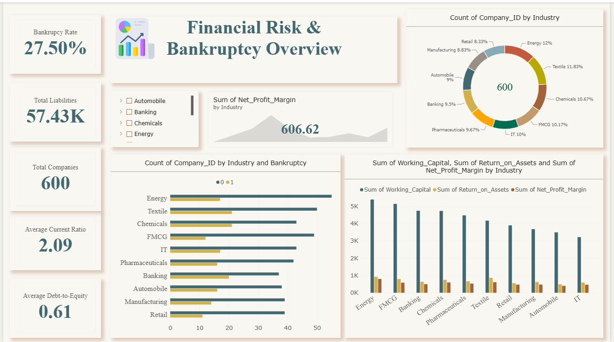
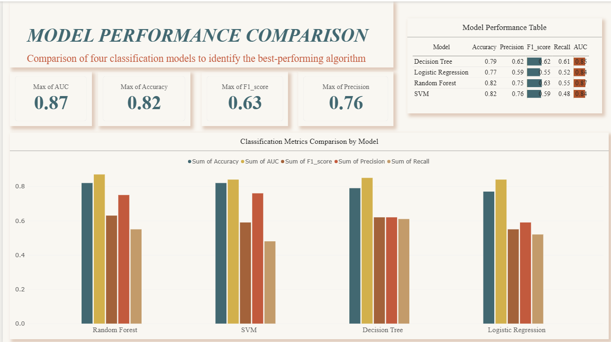

# Corporate Bankruptcy Prediction & Model Evaluation (Power BI & ML)

An end-to-end financial risk analytics and machine learning evaluation report analyzing **600 companies across 10 industries** to assess corporate bankruptcy indicators and compare four classification algorithms.

## 🎯 Executive Summary (At a Glance)

| Metric / Focus Area | Key Finding |
| :--- | :--- |
| **Total Companies Analyzed** | **600 companies** across **10 industries** (`Train` and `Test` splits) |
| **Overall Bankruptcy Rate** | **27.50%** (165 bankrupt vs. 435 healthy companies) |
| **Financial Health Averages** | **2.09** Average Current Ratio, **0.61** Average Debt-to-Equity, and **57.43K** Total Liabilities |
| **Top ML Classification Model** | **Random Forest** achieved the highest **AUC (0.87)**, **F1-Score (0.63)**, and **Accuracy (0.82)** |

## 📑 Report Breakdown

### 1. Financial Risk & Bankruptcy Overview

* **Industry Distribution:** **Energy (12.0%)**, **Textile (11.83%)**, and **Chemicals (10.67%)** represent the largest industry shares in the dataset, followed by **FMCG (10.17%)** and **IT (10.0%)**.
* **Bankruptcy Concentration:** **Chemicals**, **Textile**, and **Banking** show higher counts of bankrupt companies (`Bankruptcy = 1`), while **Energy** and **FMCG** maintain stronger healthy company ratios.
* **Liquidity & Leverage:** Interactive industry slicers allow filtering working capital, return on assets, net profit margins, current ratios, and debt-to-equity metrics across all 10 sectors.

### 2. Classification Model Performance Comparison

* **Best Overall Model:** **Random Forest** delivered the strongest overall discrimination (**AUC: 0.87**), highest **F1-Score (0.63)**, and tied for highest **Accuracy (0.82)**.
* **Model Trade-Offs:** **SVM** achieved the highest **Precision (0.76)** (minimizing false bankruptcy alerts), whereas **Decision Tree** recorded the highest **Recall (0.61)** (identifying the largest share of actual bankruptcies).

## 📈 Classification Metrics Summary

| Model | Accuracy | Precision | Recall | F1-Score | AUC |
| :--- | :---: | :---: | :---: | :---: | :---: |
| **Random Forest** | **0.82** | 0.75 | 0.55 | **0.63** | **0.87** |
| **SVM** | **0.82** | **0.76** | 0.48 | 0.59 | 0.84 |
| **Decision Tree** | 0.79 | 0.62 | **0.61** | 0.62 | 0.85 |
| **Logistic Regression** | 0.77 | 0.59 | 0.52 | 0.55 | 0.84 |

## 📁 Repository Folder Contents
* `corporate_bankruptcy_dashboard.pbix` – Interactive 2-page Power BI Desktop report file
* `Corporate_Bankrupcy_data.csv` – Source financial dataset across 600 companies
* `MODEL COMPARISON TABLE.text` – Classification model evaluation metrics dataset in text formate
* `01_financial_overview.png` – Page 1 financial risk & industry breakdown preview
* `02_model_comparison.png` – Page 2 ML model performance comparison preview
* `README.md` – Project documentation and analytical insights
